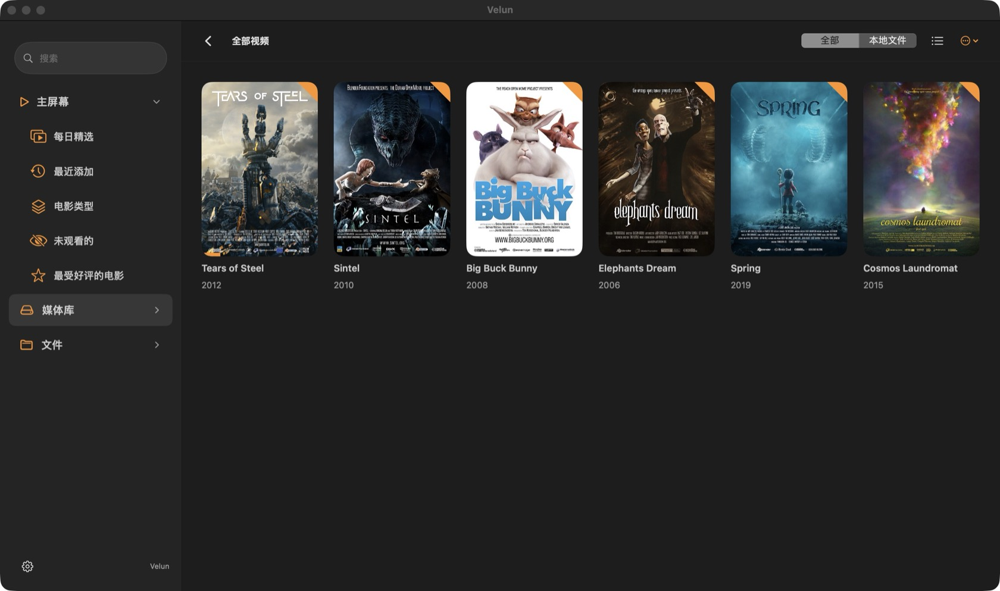
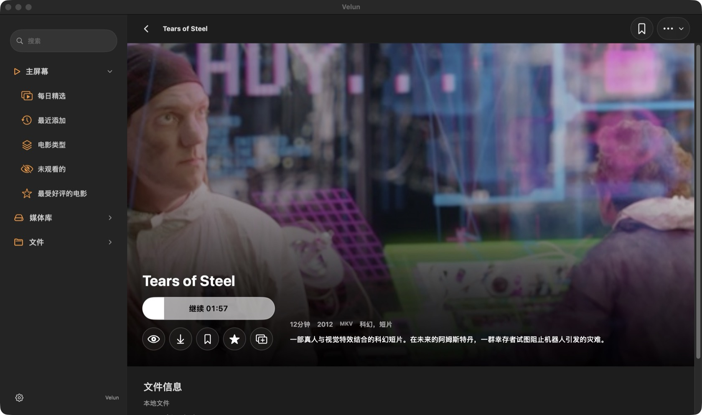

# Velun

[简体中文](README.md) · English

**A personal media player for Mac.** Velun takes inspiration from Infuse's poster wall, episode pages, and playback controls. If you enjoy browsing and resuming shows in Infuse and want an open-source macOS app for your local or NAS library, give Velun a try. Velun is independent of Infuse and Firecore.

## Screenshots





[Artwork sources and licenses](docs/screenshots/CREDITS.md)

## Features

- **Local and NAS libraries** · Add local folders, SMB, WebDAV, or Alist. You can also connect to Jellyfin, Emby, and Plex.
- **Posters and episodes** · Browse artwork and cast, manage favorites, pick episodes by season, and resume where you left off.
- **Media playback** · AVFoundation and libmpv support formats including MKV, selectable audio and subtitle tracks, HDR10 / HLG, and AirPlay for compatible videos.

## Downloads and builds

See [GitHub Releases](https://github.com/superzhang/Velun/releases) for downloads and system requirements. The current build targets Apple Silicon, and the app bundle requires macOS 27.2 or later.

To run from source, install Xcode and Homebrew:

```sh
brew install mpv ffmpeg rclone
swift run
swift test
```

To build the app bundle, install a valid Apple code-signing certificate and run `./scripts/build-app.sh`. Set `LUMA_SIGNING_IDENTITY` if you have multiple certificates. The script writes `Velun.app` to the parent directory.

## Set up TMDB posters

Video playback works without TMDB. For automatic artwork and metadata matching, request credentials with your own TMDB account. The project and release package ship without preconfigured credentials.

1. Sign in to TMDB and request API credentials in your [account's API settings](https://www.themoviedb.org/settings/api).
2. Copy the **API Read Access Token**. This is the value the app's field accepts.
3. In Velun, go to **Settings → TMDB → Artwork & Metadata → Read Access Token** (shown as **偏好设置 → TMDB → 海报与影片信息 → 读取访问令牌** in the current interface). Paste the token and click **保存令牌** (Save Token). You can then enable automatic matching or look up artwork for unmatched videos.

Velun stores the token in the local macOS Keychain. For details, see [TMDB's authentication guide](https://developer.themoviedb.org/docs/authentication-application).

## License

Velun's source is licensed under [GPL-3.0-or-later](LICENSE). See [THIRD_PARTY.md](THIRD_PARTY.md) for dependencies and attribution.
